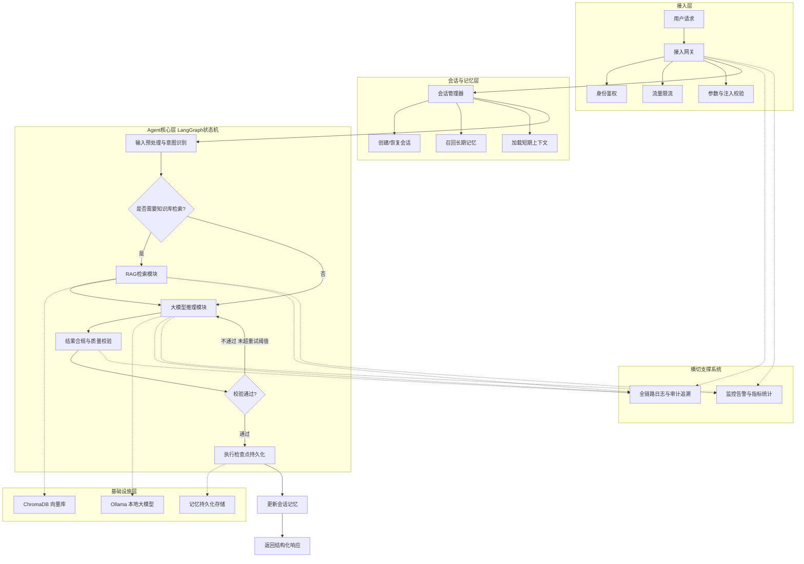
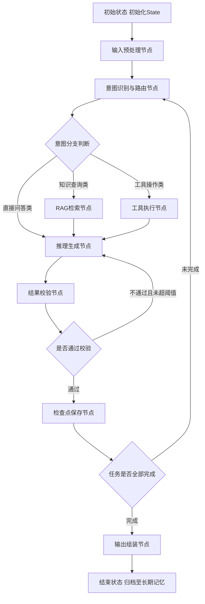
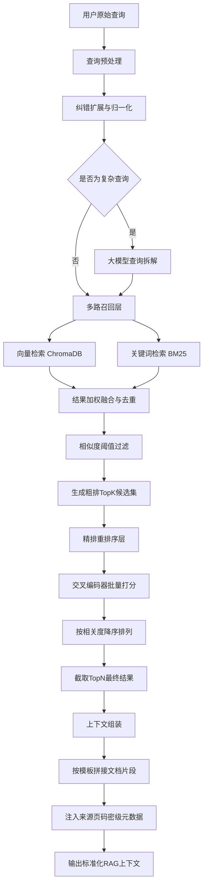
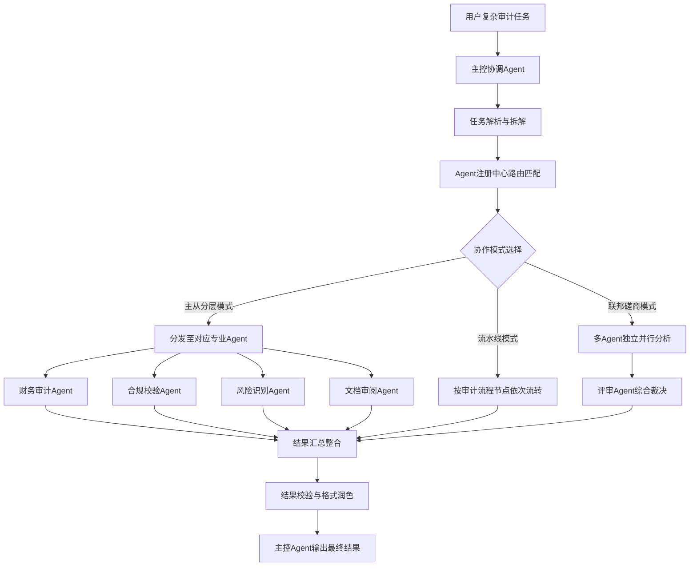

### 一、系统总体端到端流程图

**视角**：宏观全链路视角，覆盖用户请求从接入到返回的完整流转，以及横切支撑系统 **核心体现**：分层架构、安全管控、记忆联动、检查点机制、全链路日志

预览

### 二、LangGraph Agent 内部状态机流程图

**视角**：Agent 内核微观视角，精准对应 LangGraph 的 State + Node + Edge 模型 **核心体现**：状态流转、分支路由、重试机制、检查点断点恢复

### 三、RAG 二阶检索详细流程图

**视角**：数据检索视角，完整呈现「粗排 + 精排」混合索引架构 **核心体现**：多路召回、结果融合、CrossEncoder 精排、占位扩展位

### 四、多智能体协作扩展流程图（预埋架构）

**视角**：未来扩展视角，对应阶段 3-4 的多 Agent 协作模式 **核心体现**：主控协调、专业 Agent 拆分、三种协作模式、平滑演进路径

